

  <a href="https://codeforces.com/profile/shesh08"></a>

  <a href="https://rbksh.vercel.app/">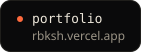</a>
  <a href="https://www.linkedin.com/in/shesh08/">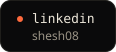</a>
  <a href="https://codeforces.com/profile/shesh08">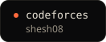</a>

The banner is a real BFS run, and my name is part of the wall (<a href="tools/bfs.py">tools/bfs.py</a>).

  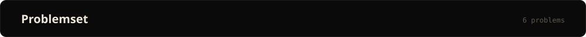
  <a href="https://github.com/rbksh/HaptiBraille">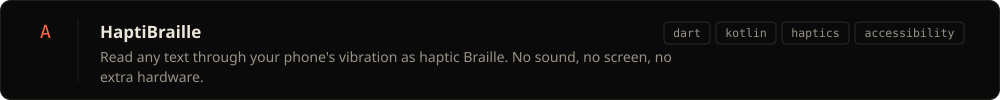</a>
  <a href="https://github.com/rbksh/benchrank">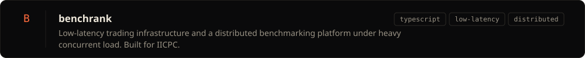</a>
  <a href="https://github.com/rbksh/poker-bot-engine">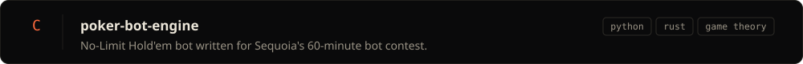</a>
  <a href="https://github.com/rbksh/colonel-blotto-s-game">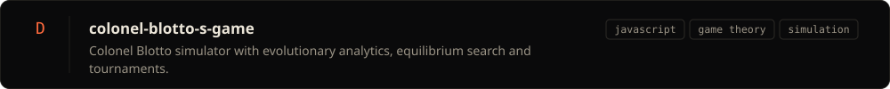</a>
  <a href="https://github.com/rbksh/Dynamic-Coin-Toss">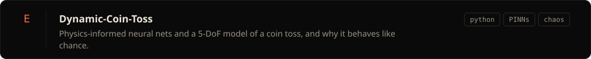</a>
  <a href="https://github.com/rbksh/Nomex">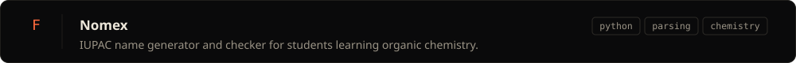</a>

  

