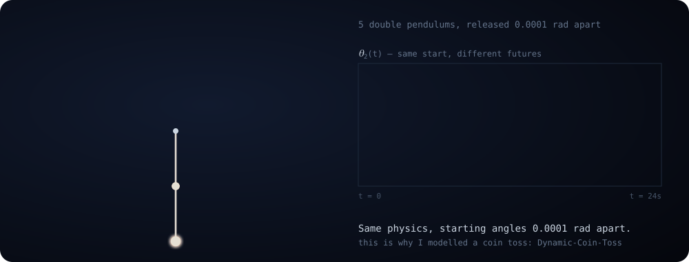

  

  
  
  

Every planet above is one of my public repos, pulled from the GitHub API. Older repos orbit farther out, bigger repos are bigger planets, and the colour is the main language. Orbital periods follow Kepler's third law, and anything I pushed to in the last two weeks glows. A GitHub Action rebuilds it every morning, so a new repo shows up as a new planet the next day ([`tools/orbit.py`](tools/orbit.py)).

I study Computer Science at **BITS Pilani**, and before that I was at **DPS RK Puram**. I'm into Machine Learning, Competitive Programming, Calculus and Theoretical Physics, and I like problems where a clean model turns into surprising behaviour.

### Things I've built

| | |
|---|---|
| **[HaptiBraille](https://github.com/rbksh/HaptiBraille)** | Read any text through your phone's vibrations as haptic Braille. No sound, no screen, no extra hardware. |
| **[Dynamic-Coin-Toss](https://github.com/rbksh/Dynamic-Coin-Toss)** | PINNs and a 5-DoF mechanical model of a coin toss, linked to chaos theory and the law of small numbers. |
| **[poker-bot-engine](https://github.com/rbksh/poker-bot-engine)** | No-Limit Hold'em bot in Python, Rust and C++, built for Sequoia's 60-minute bot contest. |
| **[benchrank](https://github.com/rbksh/benchrank)** | Low-latency trading infra and a distributed benchmarking platform for high-concurrency load (IICPC hackathon). |
| **[colonel-blotto-s-game](https://github.com/rbksh/colonel-blotto-s-game)** | Colonel Blotto simulator with evolution analytics, equilibrium search and tournaments. |
| **[Nomex](https://github.com/rbksh/Nomex)** | IUPAC name generator and checker for students working through organic chemistry. |

### Chaos, briefly

  

These five pendulums start 0.0001 rad apart. They move as one for about six seconds, then the tiny difference blows up. The physics is integrated with RK4 in [`tools/chaos.py`](tools/chaos.py) and replayed frame by frame in pure SVG.

  

All of this is plain SVG generated by the Python scripts in <a href="tools/">tools/</a>. There are no GIFs and no third-party widgets.
